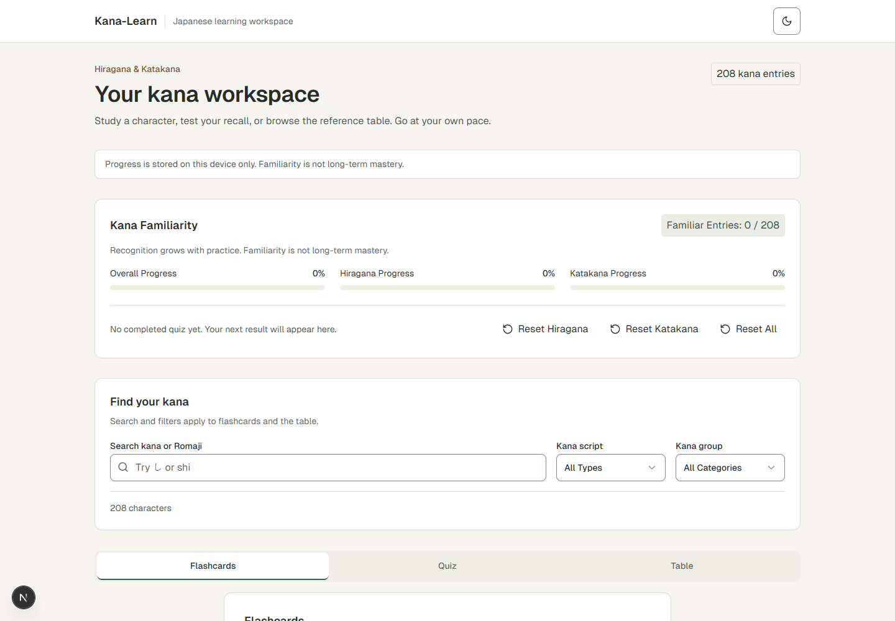
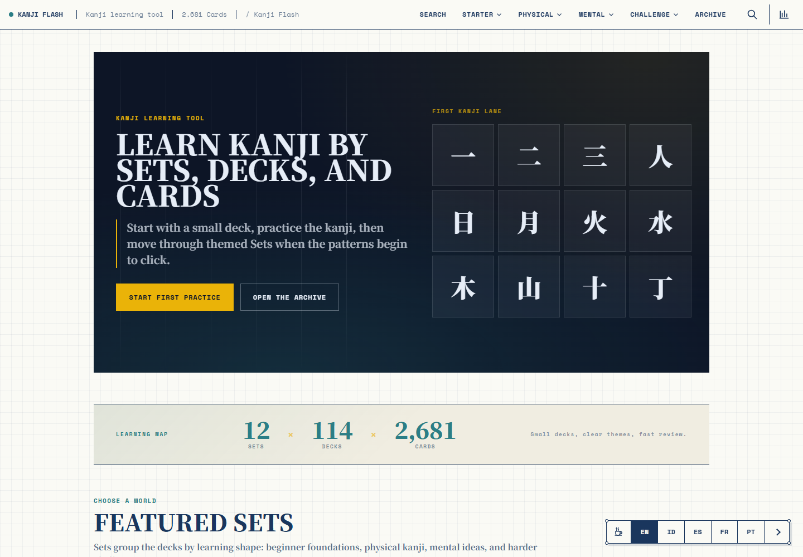
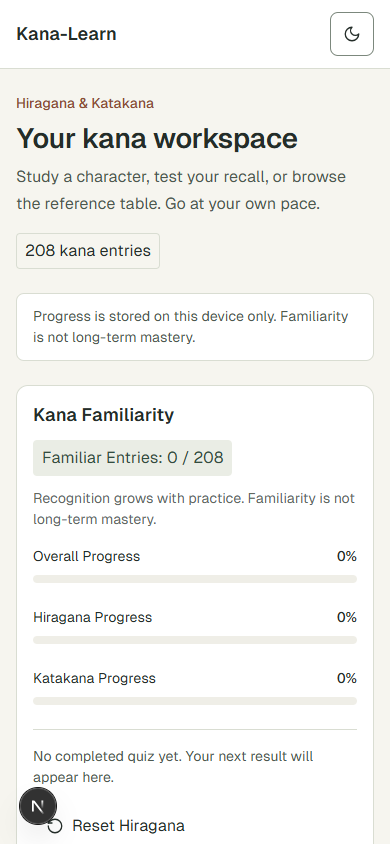
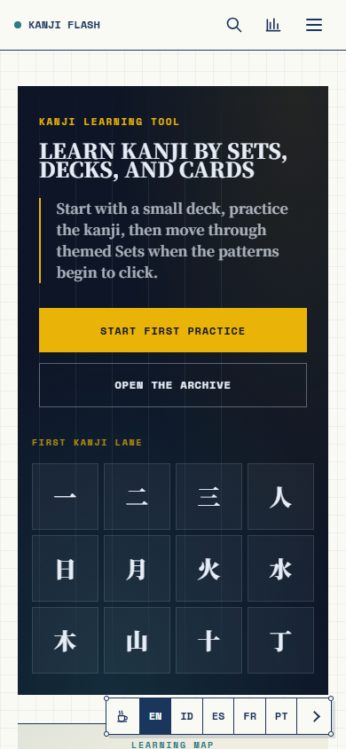
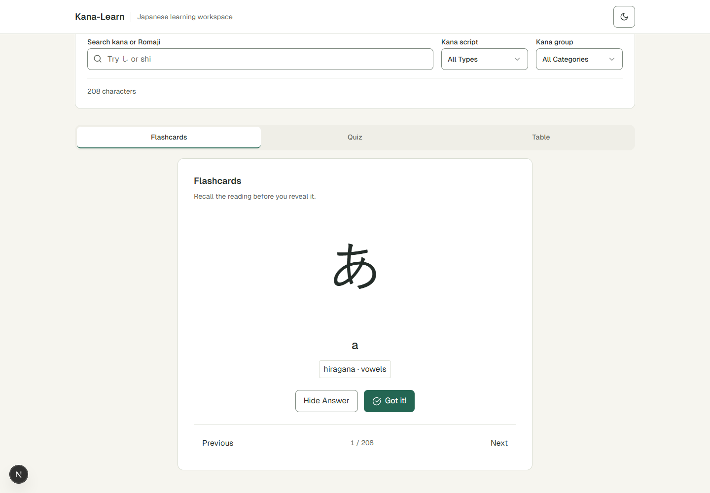
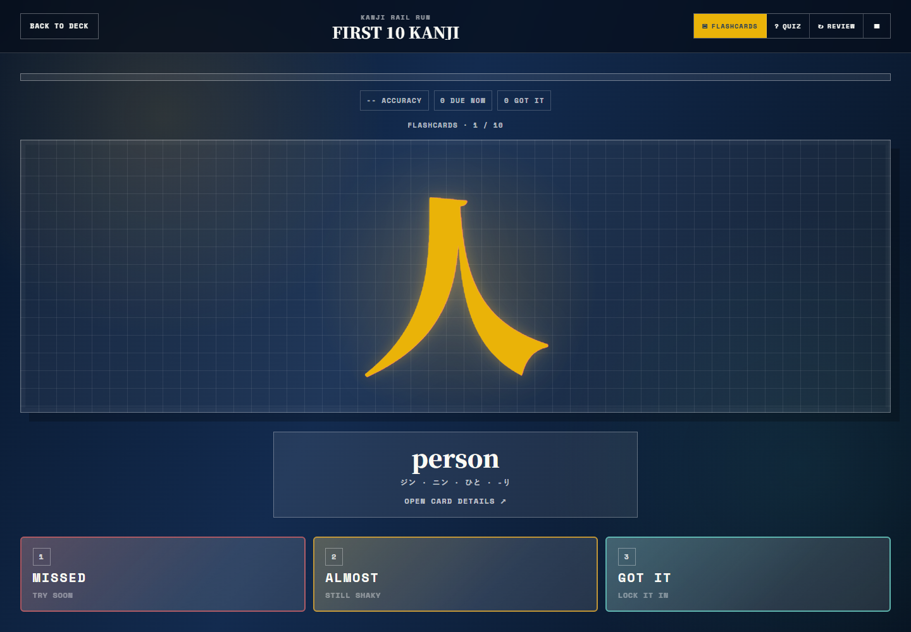

# Perbandingan Kana-Learn dan KanjiFlash
Tanggal pemeriksaan: 25 Oktober 2026, Asia/Jakarta.

> Audit historis sebelum perombakan Sakura. Deskripsi Kana-Learn di sini merekam implementasi lama, bukan aplikasi setelah perombakan. Source backend/test lama dipertahankan di docs/archive/pre-sakura; arsitektur aktif dijelaskan pada README dan implementation-plan di root.

## Hasil utama
Kana-Learn sudah menjadi workspace latihan kana yang rapi dan terfokus. KanjiFlash memiliki cakupan konten, navigasi materi, review kartu lemah, dan presentasi progres yang lebih luas. Kesenjangan paling mendesak pada UI lokal adalah jarak menuju aktivitas belajar: progress dan filter memenuhi layar sebelum kartu latihan terlihat.

“Web Anda saat ini” di laporan ini berarti working tree C:/Project/kana-learning, termasuk perubahan yang belum di-commit, dijalankan di http://127.0.0.1:3000. Tidak ada URL deployment lokal yang diberikan, sehingga hasil ini tidak menyatakan kondisi situs produksi Anda.

## Metode dan batas pemeriksaan
- Skill reverse-engineer-anything diterapkan. REA MCP capture_browser_scenario menjalankan Chrome dengan profil sementara: membuka halaman, klik mode, membuka jawaban, memberi rating Missed, berpindah Review, membuka Save Data, dan memilih filter lokal.
- Desktop 1440×1000 dan mobile 390×844, light environment, locale en-US, timezone Asia/Jakarta. Screenshot practice KanjiFlash tetap gelap sesuai desain halaman tersebut.
- Source aktif lokal dibaca menggunakan alat repository biasa, karena tersedia source lengkap. README/rencana tidak diperlakukan sebagai bukti bahwa fitur mendatang telah terimplementasi.
- Halaman publik KanjiFlash juga diperiksa melalui web MCP. Detail runtime, screenshot, accessibility tree, dan Evidence disimpan oleh REA.
- Ini inspeksi fungsional terpilih dan visual, bukan audit aksesibilitas lengkap, pengukuran performa produksi, atau verifikasi seluruh 2.681 kartu.
- Pemeriksaan awal UI belum menentukan algoritma review; analisis backend lanjutan di bawah menemukan jadwal tetap di bundle client. Tidak ada bukti penggunaan FSRS/SM-2 atau pengujian efektivitas retensi.
- Export/Import, print, save slots, theme/accent dan pilihan bahasa teramati pada UI; pemulihan save, hasil cetak, dan kelengkapan terjemahan tidak diuji.
- Tidak ada source aplikasi, database schema, atau data progres pengguna yang diubah. Sesi browser memakai profil sementara dan seluruh browser milik REA dihentikan otomatis.

## Perbandingan fitur

| Area | Kana-Learn saat ini | KanjiFlash teramati | Implikasi |
|---|---|---|---|
| Materi | 208 kana: 104 Hiragana +104 Katakana | Halaman menampilkan 2.681 kanji, 12 Sets, 114 Decks | Produk berada pada lingkup belajar berbeda; jumlah konten bukan skor kualitas |
| Organisasi | Satu workspace; script dan kelompok kana | Set → Deck → Card, halaman archive, deck overview, practice terpisah | KanjiFlash memberi jalur eksplorasi dan tahap belajar yang lebih jelas |
| Flashcards | Reveal/hide Romaji, previous/next, Got it!, Familiar | Reveal makna/bacaan, Missed/Almost/Got It, tautan detail | Penilaian KanjiFlash membedakan tingkat kesulitan yang dirasakan |
| Quiz | Kana → Romaji; script sendiri; 5/10/15/20/25 soal; feedback dan hasil | Sesi contoh menampilkan makna → pilihan empat kanji, 10 soal sesuai deck | Lokal unggul dalam pengaturan jumlah soal yang sudah terverifikasi; arah latihan berbeda |
| Review | Review jawaban pada hasil quiz | Review kartu lemah; kartu yang diberi Missed masuk Review dalam sesi uji | Review hasil dan antrean latihan ulang adalah dua fitur berbeda |
| Progres | Overall/Hiragana/Katakana Familiarity dan last quiz | Cards Seen, Known, Mastered, Accuracy, Due Now, Runs, progres per deck | Dashboard KanjiFlash lebih membantu memilih aktivitas berikutnya |
| Motivasi | Persentase familiar; tanpa XP/level | Player, level, EXP dan rekomendasi Next Run | Gamifikasi terlihat lebih kaya; label Mastered bukan bukti penguasaan jangka panjang |
| Persistensi | localStorage; satu active quiz +20 history; resume refresh; snapshot soal/jawaban | Local progress tanpa akun; Save Slot, New, Duplicate, Rename, Export Save, Import Save | Lokal sudah punya kontinuitas sesi; backup/transfer save belum tersedia |
| Pencarian | Glyph/Romaji, filter script dan group | Pencarian kanji, reading, meaning, deck dan set | KanjiFlash mencari di beberapa jenis konten |
| Referensi | Table Character/Romaji per kategori | Halaman kanji: arti, Onyomi/Kunyomi, radical, stroke count, JLPT/grade, kosakata, Compare Kanji, related decks | Kedalaman konteks adalah pembeda besar |
| Bahasa dan tampilan | UI Inggris; system/light/dark | EN/ID/ES/FR/PT links; light/dark; Asagi/Beni/Yamabuki accents | Pilihan bahasa Indonesia sudah tampak pada kompetitor |
| Publikasi dictionary lokal | Published-only backend API kanji/vocab tersedia; belum real release dipublikasikan dan belum ada learning UI | Materi kanji sudah dapat dibuka dan dipraktikkan | Fondasi backend lokal tidak boleh dihitung sebagai fitur belajar publik aktif |

Fakta lokal: README.md:3–15; app/page.tsx:25,75,107; components/kana/flashcard-mode.tsx:50; components/kana/quiz-mode.tsx:76,130,151; lib/study/local-store.ts:60; lib/kana/search.ts:3; components/kana/table-view.tsx:42; server/services/dictionary.ts:31.

Sumber publik: [Beranda](https://kanjiflash.com/), [deck awal](https://kanjiflash.com/deck/first-10-kanji), [practice](https://kanjiflash.com/deck/first-10-kanji/practice), [dashboard](https://kanjiflash.com/dashboard), [detail 日](https://kanjiflash.com/card/%E6%97%A5), [search](https://kanjiflash.com/search), [about](https://kanjiflash.com/about).

## Perbandingan backend dan penyimpanan data

Pembaruan pemeriksaan backend: 25 Oktober 2026. Kesimpulan berikut menggantikan ketidakpastian awal terkait mekanisme penyimpanan dan review pada bagian sebelumnya.

### Jawaban: database atau localStorage?

**Progres belajar KanjiFlash terbukti disimpan di localStorage. Materi kanji/deck dikirim oleh server/CDN melalui HTML dan API publik. Penggunaan database internal server belum dapat ditentukan dari bukti publik yang diperiksa.**

Dua jenis data ini perlu dipisahkan. Menyimpan progres di browser tidak berarti seluruh situs hanya menggunakan browser storage; keberadaan endpoint JSON juga tidak membuktikan penggunaan PostgreSQL, MySQL, SQLite, Supabase atau database tertentu. API dapat membaca database, berkas, hasil build atau cache.

| Jenis data/lapisan | Kana-Learn — source lokal tersedia | KanjiFlash — REA pada situs publik |
|---|---|---|
| Materi utama | PostgreSQL/Supabase melalui server; tabel learning.kana dan view published_materials untuk dictionary | Data practice disisipkan di respons HTML; katalog dikirim dari GET /api/dashboard-data |
| Database server | Terverifikasi dari Postgres.js, Drizzle, schema, services dan dokumen setup | Belum terkonfirmasi; tidak tersedia source server, konfigurasi deploy, schema atau query DB |
| Progres/familiarity | localStorage di perangkat, terpisah dari DB materi | localStorage dengan save slot; perubahan rating memperbarui hash record lokal |
| Quiz/hasil | Satu active quiz dan20 history lokal | Card progress, sessions, EXP/level, nextReviewAt dan ringkasan deck ada dalam format save lokal |
| Perhitungan belajar | Quiz dinilai di browser | Rating, benar/salah, EXP, level, review dan ringkasan dashboard dihitung di bundle client |
| API konten | /api/v1/content/kana, /kanji, /vocabulary melalui Next/Elysia | /api/dashboard-data teramati benar-benar diminta saat dashboard dibuka dan merespons200 JSON |
| Cloud progress/account | Tidak ada learner account/sync pada implementasi aktif | Tidak ditemukan alur sinkronisasi progres pada sampel; kebijakan publik menyatakan data belajar tetap di browser |
| Cache/delivery | Kana memakai ETag/revalidation; dictionary no-store pada implementasi ini | Cloudflare teramati; response practice memiliki x-html-cache:HIT dan TTL2592000 detik |
| Export/import | Belum tersedia pada UI lokal | Bundle membuat JSON Blob untuk download dan membaca/validasi file di browser; tidak memerlukan upload server pada kode yang diperiksa |

Fakta lokal dari source aktif: [DB client](../../archive/pre-sakura/server/db/client.ts), [content schema](../../archive/pre-sakura/server/db/content-schema.ts), [kana/content service](../../archive/pre-sakura/server/services/content.ts), [API](../../archive/pre-sakura/server/api/app.ts), [content fetcher](../../archive/pre-sakura/lib/content/client.ts), [familiarity store](../../archive/pre-sakura/lib/study/familiarity-store.ts), [study store](../../archive/pre-sakura/lib/study/local-store.ts), [backend setup](../../archive/pre-sakura/docs/backend-setup.md). Koneksi DB live tidak diulang untuk pemeriksaan ini; konfirmasi arsitektur lokal berasal dari source dan dokumentasi, bukan audit ulang konfigurasi remote.

### Bukti REA: penyimpanan progres di browser

REA inspect_web_page mengamati key localStorage berikut pada profil Chrome sementara:

- kanjiflash.slots.v1 — indeks save slot.
- kanjiflash.activeSlot.v1 — slot aktif.
- kanjiflash.progress.v1.<slot-id> — payload progres per slot.

Nama key dan penggunaan getItem/setItem juga ditemukan pada bundle /static/client.js. Pada fungsi penyimpanan Y, payload diproses lalu ditulis dengan setItem(ri(e.slot.id), JSON.stringify(X(e))). Struktur yang dibaca/ditulis mencakup profile, cards, decks dan sessions; pembaruan kartu mencakup encounters, correct, wrong, state, lastPracticedAt dan nextReviewAt. Kode menghitung totalExp dan level di client.

Eksperimen runtime:
1. Buka practice dalam profil sementara.
2. Mulai flashcard, reveal jawaban, pilih Missed.
3. Hash payload progres dan indeks slot berubah; key slot aktif tetap.
4. Reload practice: hash payload tetap sama setelah rating, sehingga record tidak hilang saat reload.
5. Pada eksperimen berikutnya pilih Got It, reload dan buka dashboard. Dashboard membaca progres yang sama:1 kartu seen/known,1 EXP, accuracy50% setelah dua encounter pada kartu yang sama.

Nilai storage tidak dicetak atau disimpan sebagai plaintext dalam capture storage; REA menyimpan nama key dan fingerprint SHA-256. IndexedDB names dan sessionStorage keys kosong pada inspeksi pasif awal; ini observasi profil tersebut, bukan jaminan untuk semua versi/alur.

Halaman [Privacy Policy](https://kanjiflash.com/privacy) secara eksplisit menyatakan theme/accent, slots, card progress, sessions, levels, experience dan timestamp disimpan di browser; transfer dilakukan melalui ekspor/impor save. Dokumen kebijakan ini menguatkan hasil source dan runtime, bukan menggantikan keduanya.

### Bukti REA: materi tetap berasal dari server/CDN

**Practice:** respons HTTP asli /deck/first-10-kanji/practice memiliki atribut data-practice-payload. Setelah JSON di-decode, payload berisi locale, initialMode, deckHref, practiceHref, deck, cards, labels; array cards berisi10 kartu. Kode client membaca dataset.practicePayload dan merender latihan dari data tersebut. Jadi materi bukan diambil dari localStorage progres.

**Dashboard:** bundle memiliki fetch('/api/dashboard-data') sebagai fallback ketika dataset.dashboardPayload tidak tersedia. Request GET tersebut juga terlihat dalam capture runtime dashboard. Pengambilan langsung endpoint publik melalui REA mengembalikan:
- Status200, Content-Type application/json.
- Payload179887 byte pada capture ini.
- Dua properti utama: cards berisi2681 record dan decks berisi114 record.
- Contoh card: id/kanji 日 dan href halaman kartu; contoh deck: hajime, judul First 10 Kanji, href practice dan daftar cardIds.
- Payload katalog ini bukan tabel progres personal. Dashboard menggabungkannya dengan save lokal untuk menghitung ringkasan pengguna.

**Delivery/cache:** header respons practice menunjukkan server:cloudflare, x-html-cache:HIT, x-html-cache-reason:cache-hit, x-html-cache-ttl:2592000 dan Cache-Control public,max-age=0,s-maxage=2592000. API dashboard pada capture langsung memiliki cf-cache-status:DYNAMIC dan x-html-cache:BYPASS. Ini bukti lapisan delivery/cache dan kebijakan respons saat capture; tidak mengidentifikasi engine database, platform origin, atau membuktikan semua HTML dibangun statis.

Alur yang teramati:

```text
KanjiFlash:
Sumber konten internal [belum diketahui: DB/file/build/cache]
  → server/CDN → HTML payload + GET /api/dashboard-data → UI latihan/dashboard
  → jawaban/rating dihitung di browser → localStorage save slot

Kana-Learn:
PostgreSQL/Supabase → server Next/Elysia + Drizzle → API konten → UI latihan
  → familiarity/quiz dihitung di browser → localStorage
```

### Network: penyimpanan progres berbeda dari analitik

Pada bundle client yang dianalisis, REA menemukan satu kandidat fetch eksplisit: /api/dashboard-data. Pemeriksaan source terfokus menemukan satu fetch, tidak menemukan XMLHttpRequest/indexedDB/sendBeacon dalam bundle aplikasi yang sama. Ini pencarian terbatas pada bundle yang tertangkap, bukan seluruh kode server maupun semua script pihak ketiga.

Pada capture metadata, langkah rate tidak memiliki request yang tercatat. POST yang tercatat adalah /cdn-cgi/rum, bersama request Simple Analytics dan font. Karena itu klaim “tidak ada request jaringan/POST” akan keliru: ada telemetry, tetapi tidak tampak endpoint upload progres belajar pada alur ini.

Batas evidence perlu dipertahankan:
- Capture metadata melaporkan completeness:incomplete/missing events, meskipun daftar budget omissions kosong; tidak dipakai untuk membuktikan tidak ada request secara universal.
- Capture awal dengan body/headers juga memiliki budget omissions pada bagian akhir, sehingga dipakai untuk bukti positif HTML/header/privacy, bukan pembuktian ketiadaan sinkronisasi.
- Capture GET /api/dashboard-data terpisah melaporkan completeness:complete dan body berhasil diparse.
- Kesimpulan penyimpanan lokal terutama disokong fungsi getItem/setItem dan jalur rating→save di source, perubahan fingerprint saat rating, persistensi reload dan kebijakan situs.

### Review ternyata memakai jadwal sederhana di client

Analisis bundle lanjutan memperjelas batas laporan awal: fungsi Ei(state, now) mengatur nextReviewAt dari waktu browser dengan interval tetap:
- again:10 menit.
- learning:1440 menit /1 hari.
- known:4320 menit /3 hari.

Fungsi antrean review memasukkan kartu berstatus again/learning atau yang sudah melewati nextReviewAt. Jadi kartu lemah dapat langsung ditawarkan ulang walaupun waktu Due Now belum lewat. Perhitungan ini berlangsung di JavaScript client; tidak ditemukan kebutuhan job scheduler server pada jalur yang diperiksa. Ini tidak membuktikan penggunaan FSRS/SM-2 dan bukan evaluasi efektivitas jadwal tersebut.

### Apakah KanjiFlash memakai database?

| Pernyataan | Status |
|---|---|
| Progres belajar memakai localStorage | Terverifikasi dari source +runtime +policy |
| Konten disediakan oleh server/API | Terverifikasi dari respons HTTP +payload |
| Dashboard butuh DB progres pengguna | Tidak ditunjukkan; kode menggabungkan katalog publik dan save lokal |
| Server memakai PostgreSQL/MySQL/SQLite/Supabase/D1/KV/R2 | Belum dapat ditentukan |
| Situs sama sekali tidak memakai database | Tidak dapat disimpulkan |
| Semua progres dikirim ke server | Tidak didukung bukti alur yang diperiksa |
| Hosting origin menggunakan Cloudflare Workers | Belum terverifikasi; header Cloudflare saja tidak cukup |

Untuk memastikan penyimpanan internal konten, dibutuhkan source/backend deployment configuration, dokumentasi arsitektur resmi yang spesifik, atau konfirmasi pengelola. Tidak dilakukan pencarian kredensial, akses panel admin, atau pemindaian endpoint tersembunyi.

### Implikasi untuk proyek Anda

Arsitektur Anda sudah memisahkan DB konten dan progres lokal. Kesenjangan fitur terhadap KanjiFlash tidak berarti Anda perlu menambah DB progres: save slots, export/import, EXP, review sederhana dan statistik deck dapat dibangun di client. Database tetap berguna untuk pengelolaan konten, provenance, revisi dan publication yang sudah menjadi bagian fondasi lokal.

Sinkronisasi lintas perangkat, backup otomatis dan progres berbasis akun memerlukan desain penyimpanan bersama beserta identitas pengguna. Fitur-fitur tersebut tidak dibuktikan sebagai kemampuan KanjiFlash pada audit ini. Tidak ada perubahan backend aplikasi yang diterapkan dalam tugas dokumentasi ini.

### Bukti backend yang disimpan

Bundle tambahan: [rea-backend-evidence.json](rea-backend-evidence.json), snapshot kumulatif20 records termasuk pemeriksaan awal; bundle lama14 records tetap disimpan.
- [Bundle JavaScript tertangkap](kanjiflash-client-captured.js), sumber publik /static/client.js; SHA-256 byte source dari REA:db8f494b97656e4c3426bb1b6080a48a0ee959a92247c856e45e17f52739ad17.
- [Potongan source dan offset UTF-16](backend-source-excerpts.json).
- [Payload practice dari respons HTML](kanjiflash-practice-payload.json).
- [Katalog API dashboard](kanjiflash-dashboard-data.json).

| Pemeriksaan | Evidence ID | Cakupan |
|---|---|---|
| Static bundle endpoint/chunk | ev_813e8bdc466925891ae6e63a4f8630a93bb8d19e17663cd1d7107e5239c8fff1 |2 script ter-parse; endpoint kandidat |
| Passive scripts/storage | ev_d07964691499e2933ad699d91ee94682d8639bfea0f2638f1652996e0dba1965 |Source bundle, storage keys/fingerprints |
| Missed→storage→reload, HTML, header, privacy | ev_1f841d08f20c77426f65510d4fb55fc9bf057f6f97448869f0f0eb43997d753b |Bukti positif; network budget omissions dicatat |
| Got It→reload→dashboard dan metadata request | ev_427c48dff705aaaf0d149ceee262cacd18305f81bc6accae52f2230d80320f42 |Progres terbaca; network completeness terbatas |
| GET API200 JSON | ev_77c769b8bbc9233301d7fc906846099934efe0a954beaf8fd6f8c202cff3effc |Complete;2681 cards,114 decks; body SHA-256:6dcf195102d19ace0507afc2f99f9106a71f7aa745fb564f1b7a300d960abe89 |


## Perbandingan UI/UX

| Aspek | Kana-Learn | KanjiFlash | Penilaian |
|---|---|---|---|
| Identitas visual | Cream #F6F5EF, kartu putih, forest green #246653, Geist sans, radius lembut | Kertas/grid blueprint, navy, teal, kuning pada practice; serif besar +Space Mono; sudut tegas, shadow offset | Lokal terasa tenang dan utilitarian; KanjiFlash lebih khas dan ekspresif |
| Halaman awal | Judul →storage notice →familiarity →filter →tabs →latihan | Hero dengan Start First Practice →learning map →Sets/Decks/Cards | KanjiFlash menjelaskan tindakan pertama lebih cepat |
| Fokus latihan | Tetap di dalam halaman panjang yang berisi statistik/filter | Ruang latihan khusus, glyph/prompt dominan, kontrol mode ringkas | Mode fokus layak diadaptasi di lokal |
| Hierarki tindakan | Reset Hiragana/Katakana/All terlihat sebelum kontrol latihan | Mulai latihan menjadi CTA utama; pengelolaan save berada di dashboard | Tindakan belajar sebaiknya mendapat prioritas visual |
| Kepadatan | Banyak ruang kosong, card spacing dan teks status berulang | Metadata lebih padat, label uppercase/mono kecil | Lokal lebih mudah dibaca; KanjiFlash berisiko ramai pada beberapa area |
| Mobile | Kolom rapi tetapi layar awal 390×844 habis oleh intro/progres; filter dan latihan lebih bawah | CTA mulai terlihat di homepage; practice review menampilkan glyph dan Show Answer pada viewport contoh | Prioritas utama lokal: kurangi scroll sebelum praktik |
| Navigasi | Tiga tab sederhana | Header kategori, breadcrumbs, archive, search, progress, link antar-card/deck | Lokal cukup untuk kana, perlu struktur baru jika kanji diperluas |
| Aksesibilitas | Skip link, focus styling, labels, semantic table, live status, reduced-motion di source | Accessible names/regions tampak pada capture | Tidak ada klaim salah satu lulus WCAG; perlu audit khusus |
| Tema | Toggle tema mudah ditemukan di header | Kontrol tema/accent ada di footer katalog | Lokal sudah unggul dalam keterlihatan pengaturan tema pada halaman utama |

### Screenshot desktop: layar awal
Kana-Learn:


KanjiFlash:


### Screenshot mobile: layar awal
Kana-Learn:


KanjiFlash:


### Screenshot ruang latihan
Kana-Learn setelah reveal (halaman sudah tergulir akibat klik REA):


KanjiFlash setelah reveal:


## Rekomendasi berurutan
1. Prioritas tinggi: tampilkan “Mulai latihan” atau “Lanjutkan quiz” di dekat judul; ringkas Familiarity; buat filter dapat dilipat; sediakan mode fokus. Pertahankan palet/typography lokal yang sudah konsisten. Target: pengguna mobile dapat memulai atau melanjutkan belajar dari layar awal.
2. Prioritas tinggi: tambahkan review khusus kana yang salah/sulit dari riwayat quiz dan rating flashcard. Pisahkan Familiarity dari hasil recall dan jadwal review; tentukan aturan penjadwalan secara eksplisit.
3. Prioritas menengah: sediakan ekspor/impor progres dengan validasi format serta indikator penyimpanan yang sudah ada. Simpan snapshot/revisi agar materi berubah tidak merusak riwayat.
4. Prioritas menengah: perjelas jalur kecil seperti Hiragana basic →dakuten →combination →Katakana, dengan subset latihan dan saran sesi berikutnya.
5. Ekspansi konten setelah data siap: terbitkan sumber dictionary yang berlisensi/teratribusi, lalu bangun detail kanji, kosakata dan deck. Backend yang tersedia belum cukup untuk menyatakan course kanji siap.
6. Bahasa Indonesia dan gamifikasi ringan dapat menyusul. Level/EXP sebaiknya tidak mendahului kejelasan latihan, kualitas konten dan kontinuitas progres.

## Yang sudah baik pada lokal
- Cakupan kana terfokus dan tidak meminta login.
- UI tenang, kontras primary jelas, tombol minimum44px, dukungan light/dark.
- Quiz configurable, resume aktif, history20, dan review jawaban.
- Data familiarity terpisah dari quiz history; pemberitahuan device-local dan memory-only saat storage gagal.
- Fondasi komponen dan API publik dapat dikembangkan tanpa mengganti keseluruhan stack.

## Catatan verifikasi tambahan
- Filter Basic kana benar-benar diuji melalui REA dan menghasilkan92 karakter. Label kategori detail pada kartu (mis. vowels) dipetakan ke kelompok basic oleh lib/kana/search.ts; ini bukan kegagalan filter.
- Halaman lokal sempat terlihat dalam status loading saat kompilasi development/API pertama, lalu materi208 berhasil dimuat. Ini tidak digunakan sebagai ukuran performa produksi.
- KanjiFlash sempat menampilkan angka nol pada dashboard profil baru; eksperimen memakai profil kosong, sehingga bukan kondisi progres pengguna sebenarnya.
- Tidak ditemukan alasan untuk mengklaim audio, handwriting recognition, offline penuh, atau cloud sync pada kedua produk dari sampel runtime ini.

## Ledger bukti REA
Bundle: rea-evidence.json (14 records, sekitar8,3MB). Screenshot index: screenshot-index.json.
Evidence mencakup artifact identitas screenshot/DOM; tidak membuktikan source backend, keseluruhan algoritma atau seluruh konten situs.

| Pertanyaan | Evidence | Status |
|---|---|---|
| Beranda KanjiFlash desktop, struktur dan theme/accent | ev_9f20f50551f612fffd0d8bc4933b10387dd8c3d3e3c9b062051ae6f075c1cdda | Terjawab untuk halaman/sesi |
| Reveal dan tiga rating | ev_2aaae5de2a8c4f459bd1644d85cc14a5d4a6ebaccb9e2a2214854f4fe3621937 | Terjawab |
| Quiz makna→kanji dan dashboard | ev_d88ab5f80c596d5b89c93dac3d74bd63d8baa32262da482059e3af1b2dec3e7a | Terjawab untuk sampel |
| Kontrol save slots/export/import | ev_644ae7664b2058eeec44b68b0470665f827805c430033c99584b7ab60ae45769 | UI terjawab; restore belum diuji |
| Missed→Review pada mobile | ev_cfdfcc2ea937d48cfe3a5f3e5a3ceb83ab7e06b7c8f886cc2f0058562db58a61 | Terjawab |
| Search dan kanji detail | ev_b89af47de6890055d80111fe3230f968bd47072788ca7d0ee5e935e7b9d65805 | Terjawab untuk sampel |
| Lokal desktop setelah materi termuat | ev_f581befbc93905199c5c51ff0022c853cbad78792f029ae9d628f0c780723b0c | Terjawab |
| Lokal mobile viewport awal | ev_a18d8c1a3289681066fa8605e62e42b5f2ceddb1c3a53ab6ac62f52cb02437b4 | Terjawab |
| Lokal reveal dan quiz setup | ev_5b2a85385c8119b7ebda5e72c693623048c6634d71b7c9143eab605482275866 | Terjawab |
| KanjiFlash mobile homepage | ev_b548c7ae2bf43fcd926e14059ecbfaf3f7ae090aa2e1eb55ad2129071a3bc818 | Terjawab |
| Lokal Basic kana filter | ev_c5624c67b970bef81f6e8c6aa815356b40adfc266a3d8e8ff033c2282b1394ed | Terjawab:92 hasil |
| Mekanisme review client | Lihat ledger backend tambahan | Interval tetap teramati; efektivitas belum diuji |
| Ketahanan save, akurasi seluruh konten, WCAG, performa, DB internal KanjiFlash | Tidak tercakup oleh sampel | Belum diverifikasi |

