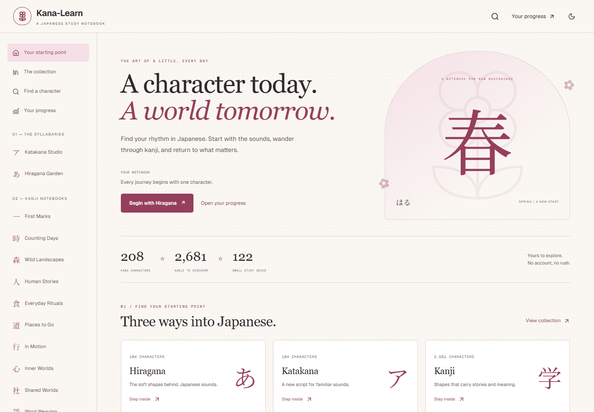
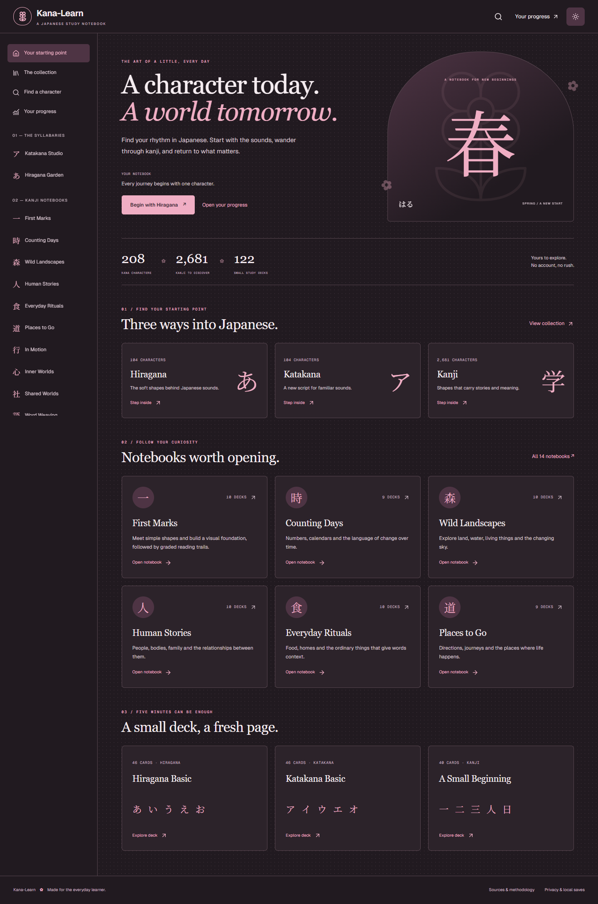
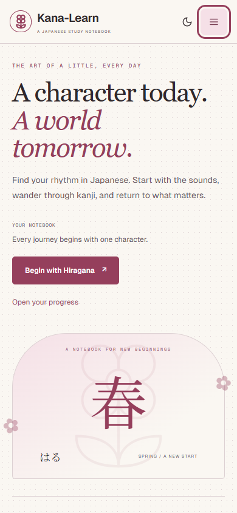
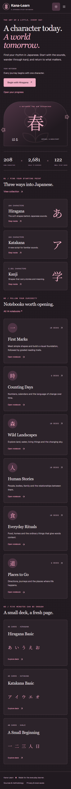
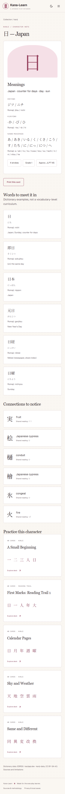
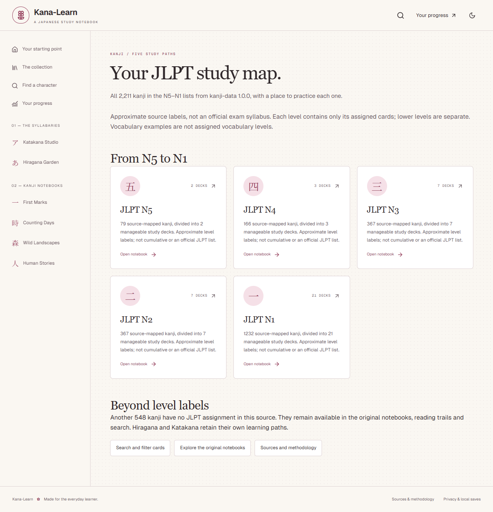

# Sakura platform — visual and browser verification

25 October2026. Final application resource revision:f1e4c122396c5e6b701f1b3156c1f377128df876660373a166f2b4804b3f3d4d.

Production Chrome browser test passed. Screenshots were captured at1440×1000 and390×844, with full-page views where useful. Manually inspected desktop light/dark, mobile light viewport and Japanese card detail; confirmed legible hierarchy, sakura identity, responsive layouts and a first-screen Begin CTA. Browser axe reported no WCAG2A/AA/2.1AA violations in tested home light/dark states. Other pages have functional/semantic tests but no full conformance certification.

The complete browser flow also verified no external font/dictionary/Supabase/progress-upload requests, no page errors, resume after rating/refresh, quiz completion, review, dashboard and export/import to a new slot with unchanged statistics.

## Desktop

## Mobile

## Character reference

[Original editorial anchors and source expansion review](topic-review.json). Fonts are served locally. Print controls and site navigation are hidden by the print stylesheet; physical printer output was not tested.

## JLPT mapping follow-up

The original captures above describe the initial2681-kanji snapshot. The expanded snapshot contains2759 kanji and208 kana, revision39784f0006ce45b4417f244cf6466825a9d9aecb2218c7b4cd17ccac5817db14. Production browser tests cover all-level overview, N1 filter, new凪 card mapping, dedicated deck and practice after refresh. Axe reported no violations on the tested overview. The separate JLPT navigation section was subsequently removed at the user’s request.

